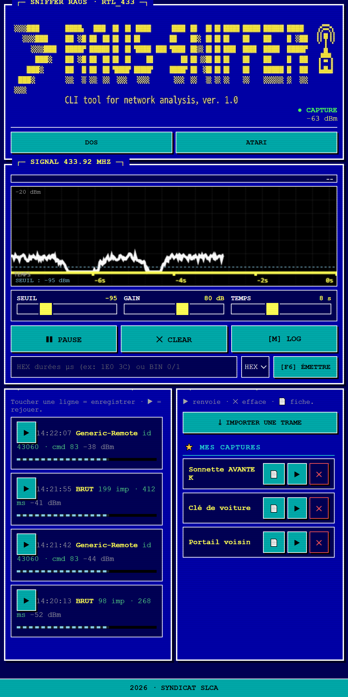
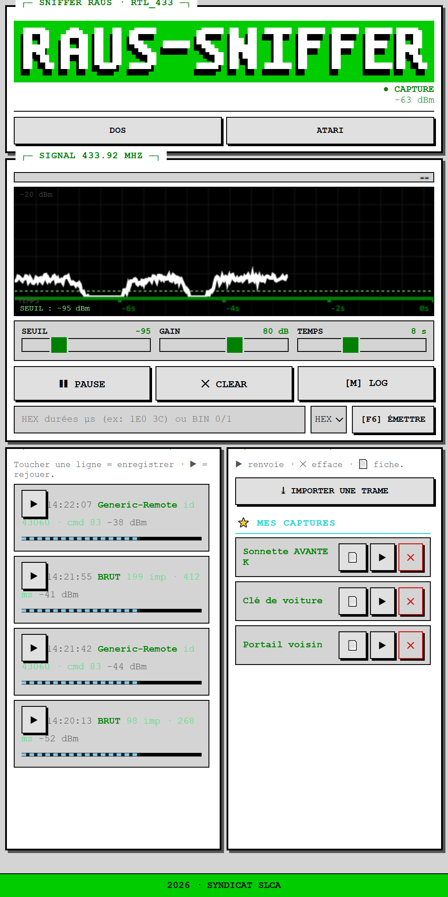

# RADAR 433 — Sniffer / Rejeu 433 MHz (ESP32 + CC1101)

Un **sniffer et analyseur 433 MHz** DIY basé sur un ESP32 et un module CC1101, avec une interface web embarquée (thème DOS / Atari), le décodage professionnel via `rtl_433_ESP`, la capture brute, le rejeu, et un moniteur système.

  

> ⚖️ **USAGE RÉSERVÉ À VOS PROPRES APPAREILS.** Projet éducatif et de diagnostic.
> Toute interception ou tout rejeu sur un appareil qui ne vous appartient pas est **illégal**
> (France : Code pénal art. 323-1 et suivants) et engage **votre seule responsabilité**.
> Voir la section [Avertissement légal & décharge](#️-avertissement-légal--décharge-de-responsabilité).

---

## 📸 Captures d'écran

**Thème DOS**


**Thème Atari ST**


---
## ✨ Fonctionnalités

- **Réception + décodage** de ~328 protocoles via [rtl_433_ESP](https://github.com/.../rtl_433_ESP) (sonnettes EV1527, télécommandes, capteurs météo…)
- **Capture BRUT** : mémorise la trame brute même si elle n'est pas décodée (clés de voiture, codes tournants…)
- **Rejeu** (TX) d'une trame capturée ou importée, avec retour RX automatique
- **Moniteur système** : flux hexadécimal continu (seuil → `0000`), logs, trames reconnues surlignées en jaune fluo
- **Catalogue** : signaux sauvegardés, classés, réutilisables
- **Import multi-format** : tableau C en µs, hex (`0x…`), binaire, et **fichiers `.sub` de Flipper** (`RAW_Data`)
- **Fiche HTML autonome** par capture (sauvegardable sur téléphone, réutilisable sur PC)
- **Thèmes** : DOS (bleu) et Atari ST (vert acide)
- **Interface WiFi** : le module crée son propre point d'accès `Radar433` → `http://192.168.4.1`

## 🔌 Câblage (CC1101 → ESP32)

| CC1101 | ESP32 |
|--------|-------|
| VCC | **3V3** (⚠️ jamais 5 V) |
| GND | GND |
| CSN (CS) | GPIO **5** |
| GDO0 | GPIO **4** |
| GDO2 | (non connecté) |
| SCK | GPIO **18** |
| MOSI | GPIO **23** |
| MISO | GPIO **19** |

> ⚠️ Toujours visser l'antenne SMA **avant** d'alimenter, et **ne jamais émettre sans antenne**.

## 🛠️ Compilation / flash

- **IDE** : Arduino IDE (ou `arduino-cli`)
- **Carte** : `ESP32 Dev Module`
- **Schéma de partition** : `Huge APP (3MB No OTA/1MB SPIFFS)`
- **Bibliothèques** : `rtl_433_ESP`, `RadioLib`
- **Flags de compilation** :
  ```
  -DRF_CC1101 -DRF_MODULE_CS=5 -DRF_MODULE_GDO0=4 -DRF_MODULE_GDO2=-1
  -DCC1101_RX_BANDWIDTH=203.125 -DCC1101_AGCCTRL0=0x93
  ```

## 🚀 Utilisation

1. Flasher `etape8_rtl433/etape8_rtl433.ino`
2. Se connecter au WiFi **`Radar433`**
3. Ouvrir **`http://192.168.4.1`**
4. `START` pour écouter, appuyer sur une télécommande, toucher la ligne pour enregistrer, `▶` pour rejouer.

## 📁 Structure

```
etape8_rtl433/      → croquis final (firmware + page web)
etape7_cc1101/      → version pré-rtl_433 (référence)
sauvegardes/        → (ignoré) snapshots locaux
```

## ⚖️ Avertissement légal & décharge de responsabilité

**Outil à double usage (*dual-use*).** Ce logiciel analyse et **rejoue** des signaux radio 433 MHz.
Il est destiné **exclusivement** à :

- l'apprentissage et la recherche en sécurité sur **vos propres appareils** ;
- le diagnostic et la réparation de vos équipements ;
- les tests **autorisés par écrit** par le propriétaire des appareils.

### ⛔ Interdictions

Il est **strictement interdit** d'utiliser ce logiciel pour :

1. intercepter, décoder ou **rejouer** les signaux d'appareils qui **ne vous appartiennent pas** ;
2. **accéder sans autorisation** à un système (portail, garage, alarme, véhicule, etc.) ;
3. contourner ou neutraliser un dispositif de sécurité ;
4. toute finalité illicite, malveillante ou portant atteinte à la vie privée d'autrui.

### 📕 Cadre juridique — France

| texte | infraction | peine encourue |
|---|---|---|
| **Code pénal, art. 323-1** | accès ou maintien frauduleux dans un système de traitement automatisé de données | **3 ans** d'emprisonnement et **100 000 €** d'amende (5 ans / 150 000 € en cas de suppression de données) |
| **Code pénal, art. 323-2** | entrave au fonctionnement d'un système | **5 ans** et **150 000 €** |
| **Code pénal, art. 226-15** | interception non autorisée de communications | **1 an** et **45 000 €** |
| **Code pénal, art. 311-1 / 313-1** | vol / escroquerie (selon l'usage fait des codes rejoués) | jusqu'à **5 ans** et **375 000 €** |

Le rejeu de codes d'accès peut également engager la **responsabilité civile** (dommages et intérêts)
et relever de dispositions spécifiques (Code de la sécurité intérieure, réglementation des
télécommunications, RGPD pour les données personnelles éventuellement captées).

**Hors de France**, des législations équivalentes s'appliquent (ex. *Computer Fraud and Abuse Act*
aux États-Unis, *Computer Misuse Act* au Royaume-Uni). **Il vous appartient de vérifier et de
respecter la loi applicable dans votre pays et votre juridiction.**

### 🛡️ Décharge de responsabilité

En téléchargeant, installant, compilant ou utilisant ce logiciel (le « Logiciel »), **vous acceptez
expressément** que :

- **vous êtes seul et entièrement responsable** de l'usage que vous en faites ;
- **l'auteur et les contributeurs déclinent toute responsabilité**, expresse ou implicite, pour tout
  dommage direct ou indirect, toute perte de données, toute interruption de service, toute poursuite
  pénale ou civile, ou tout préjudice résultant de l'utilisation ou de l'impossibilité d'utiliser le
  Logiciel ;
- le Logiciel est fourni **« en l'état » (*as is*)**, **sans garantie d'aucune sorte**, y compris
  sans garantie de qualité marchande, d'adéquation à un usage particulier ou d'absence de
  contrefaçon (voir [LICENSE](LICENSE)) ;
- **aucun droit ni autorisation** n'est concédé pour un usage illégal ;
- l'auteur **ne saurait être tenu responsable** des conséquences d'une modification, d'un fork ou
  d'une redistribution du Logiciel par un tiers.

### 🧭 Éthique

Ce projet est **éducatif** : comprendre la radiofréquence, la modulation OOK, le décodage et le
rejeu, sur **son propre matériel**. Un outil de sécurité sert à **protéger**, pas à attaquer.

## 📜 Licence

MIT — voir [LICENSE](LICENSE).
